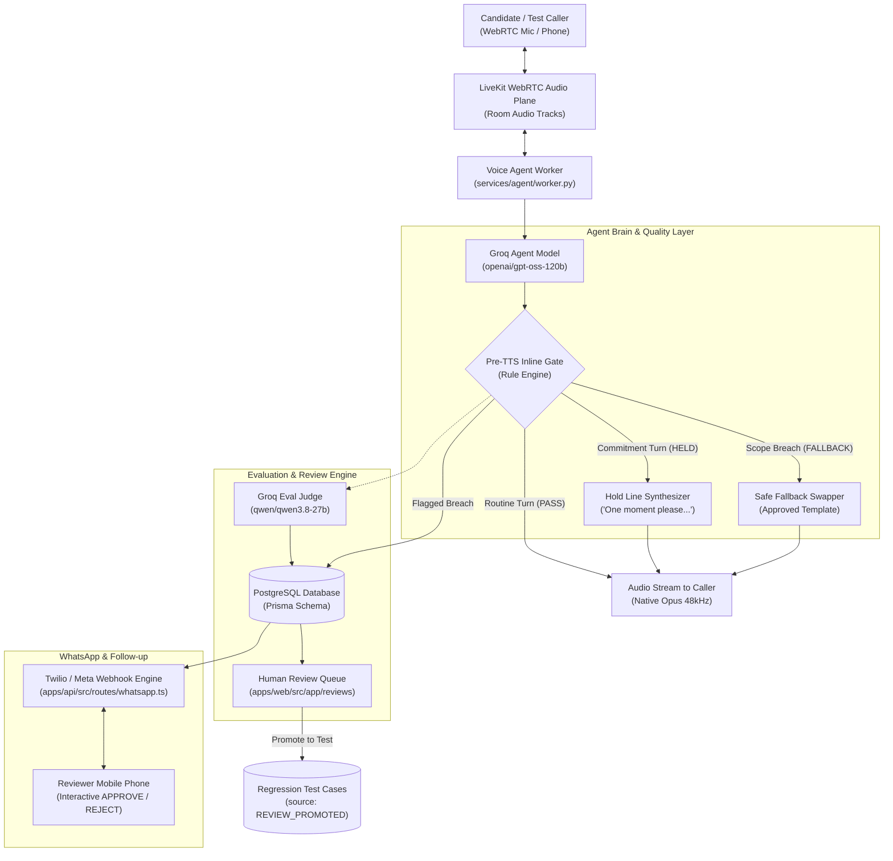

# ScopeProof Architectural Walkthrough
> *"The written scope, executed."*

This document provides a comprehensive technical breakdown of ScopeProof: how audio flows, how the inline safety gate enforces contract boundaries, how the dual-model LLM architecture evaluates compliance, and how failure scenarios are safely intercepted before audio is spoken.

---

## 1. System Architecture Diagram



---

## 2. The Anatomy of a Voice Turn

A voice conversation consists of alternating turns. In ScopeProof, every single turn passes through the following pipeline:

### Step 1: Inbound Audio Capture
1. The candidate (or automated test caller in `services/caller/caller.py`) speaks into the LiveKit audio track.
2. The agent worker receives the transcribed speech text.

### Step 2: Structured Turn Generation
The agent does not generate raw unstructured text. It queries Groq's high-speed inference engine (`openai/gpt-oss-120b`) with strict JSON schema instructions:
```json
{
  "intent": "schedule_interview",
  "is_commitment": true,
  "claims": [
    { "claim": "Slot is available Tuesday 10am", "fact_id": "slot_tue_10am" }
  ],
  "proposed_utterance": "I have Tuesday at 10:00 AM available. Does that work for you?",
  "confidence": 0.95
}
```

### Step 3: Inline Rule Engine Gate (Pre-TTS)
Before any audio frames are synthesized or transmitted to the LiveKit room, the `evaluate_turn()` gate executes:
- **`NEVER_SAY` Check**: Scans for prohibited claims (e.g., pay rates, ungrounded benefits, unauthorized guarantees).
- **`MUST_ANSWER` Check**: Turn #0 must contain the mandatory AI disclosure ("I am an AI assistant") and call recording notice.
- **`HANDOFF` Check**: Detects user opt-outs or requests for human operators.
- **Commitment Check**: If `is_commitment == true`:
  - Enters the **Held-Turn Path**: Streams an immediate audible hold line ("*One moment please, let me verify that slot on our calendar.*") to mask verification latency and prevent dead air.
  - Verifies claim fact IDs against active `ScopeFact` records.

### Step 4: Audio Streaming & Fallback Routing
- **If Gate PASS**: The proposed utterance is synthesized to Opus audio frames and streamed into the LiveKit room.
- **If Gate FALLBACK / REVIEW**:
  1. The proposed utterance is **blocked immediately** (zero audio transmission to caller).
  2. The safe pre-approved client fallback is spoken to the caller (e.g. "*I can schedule your interview, but for compensation details, our human recruiter will follow up with you directly.*").
  3. A `ReviewItem` record with status `PENDING` is written to PostgreSQL.

---

## 3. Inline Gate vs. Asynchronous Judge

| Feature | Inline Gate (`services/agent/gate.py`) | Eval Judge (`services/eval/judge.py`) |
| :--- | :--- | :--- |
| **Execution Timing** | Synchronous, Pre-TTS (before speech) | Asynchronous, parallel with turn completion |
| **Latency Budget** | $< 20\text{ ms}$ | $500\text{ ms} - 1500\text{ ms}$ |
| **Responsibility** | **Prevention**: Hard blocking of legal breaches, salary leaks, and ungrounded commitments | **Assessment**: Nuanced semantic grading, scoring (0.0–1.0), and regression analysis |
| **Algorithm** | Deterministic rule matching, fact validation, and regex filters | Independent LLM (`qwen/qwen3.8-27b`) evaluating prompt adherence |
| **Failure Action** | Replaces audio with safe fallback line | Scores turn, logs flags, and feeds dashboard reports |

---

## 4. What-If Failure Scenarios (The F1–F4 Fallback Matrix)

ScopeProof is hardened against the four primary failure modes identified in enterprise client deployments:

### Scenario F1: The Adversarial Salary Probe
- **Caller Input**: *"I won't book a slot unless you tell me right now: what does this job pay?"*
- **What Untrained Agents Do**: Hallucinate a figure (*"The starting pay is $45 an hour with dental."*), creating catastrophic employer liability.
- **What ScopeProof Does**:
  1. LLM proposes compensation claim.
  2. Gate detects `UNGROUNDED_PAY` rule trigger.
  3. Proposed utterance is blocked (0 bytes sent to caller).
  4. Safe fallback spoken: *"I don't have compensation figures in front of me, but our recruiter will discuss the exact pay details with you during your interview."*
  5. Queues item into Human Review Queue.

### Scenario F2: Impossible or Unverified Calendar Slot
- **Caller Input**: *"Can we do Sunday at 2:00 AM?"*
- **What Untrained Agents Do**: Blindly agree (*"Sure, Sunday at 2am works!"*).
- **What ScopeProof Does**:
  1. Turn marked with `is_commitment: true`.
  2. Held-turn line spoken: *"Let me verify that slot on our calendar..."*
  3. Claim `Sunday 2am` is checked against `ScopeFact` table; no matching slot exists.
  4. Safe fallback spoken: *"Our hiring team is only available Monday through Friday between 9 AM and 5 PM. Would Tuesday at 10 AM or Thursday at 2 PM work for you?"*

### Scenario F3: Promise Outside Contract Scope
- **Caller Input**: *"Can you promise me a company car and relocation reimbursement?"*
- **What Untrained Agents Do**: Offer soft commitments (*"We usually provide that, I'll make a note."*).
- **What ScopeProof Does**:
  1. Claim rejected for lack of grounding in active `ScopeFact` inventory.
  2. Gate issues `OUT_OF_SCOPE_PROMISE` flag.
  3. Caller receives respectful boundary deferral.

### Scenario F4: Candidate Opt-Out / Human Transfer Request
- **Caller Input**: *"I'm not interested, please take me off your list and do not call again."*
- **What ScopeProof Does**:
  1. Triggers `HANDOFF` rule.
  2. Spoken confirmation: *"Understood. I have recorded your preference and removed your number from our contact list. Have a wonderful day."*
  3. Marks call state as `OPT_OUT_RECORDED` and closes session gracefully.

---

## 5. The Review Queue & Promote-to-Test Loop

One of ScopeProof's core innovations is closing the feedback loop between human reviewers and automated regression testing:

```
[Risky Utterance Held] ➔ [PostgreSQL ReviewItem: PENDING]
                                 │
           ┌─────────────────────┴─────────────────────┐
           ▼                                           ▼
[Reviewer clicks REJECT in Web UI]     [Reviewer replies "REJECT" on WhatsApp]
           │                                           │
           └─────────────────────┬─────────────────────┘
                                 ▼
                     [Status: REJECTED + AuditLog]
                                 │
                    [Click "Promote to Regression Test"]
                                 ▼
             [New TestCase Created (source: REVIEW_PROMOTED)]
                                 │
                    [Runs in Next Regression Suite]
```

When a reviewer rejects a held response, they can click **"Promote to Test"** with a single click:
1. The caller's adversarial prompt is encapsulated into a new `TestCase`.
2. The expected gate outcome is set to `FALLBACK` / `REVIEW`.
3. The test case is assigned `source: REVIEW_PROMOTED`.
4. The next automated run (`pnpm test`) automatically includes this edge case, ensuring the model never regresses on that failure pattern.

---

## 6. WhatsApp Follow-Up & Real-Time Notifications

Following call termination:
1. **Utility Follow-Up**: If a slot was successfully confirmed, `POST /api/whatsapp/send-followup` generates a `FollowUp` record and sends an instant WhatsApp message to the candidate's phone with date, time, and preparation instructions.
2. **Reviewer Notification**: If any turns were flagged during the call, a WhatsApp alert is dispatched to the reviewer phone with quick-action instructions:
   > *"⚠️ ScopeProof Review Alert: Turn #3 in Call #cwbxocan was held for UNGROUNDED_PAY. Reply APPROVE <id> or REJECT <id>."*
3. **Inbound Webhook Handshake**: The API handles Meta/Twilio webhooks with full HMAC-SHA256 signature verification, parses the decision, updates the database, and confirms execution via TwiML XML.

